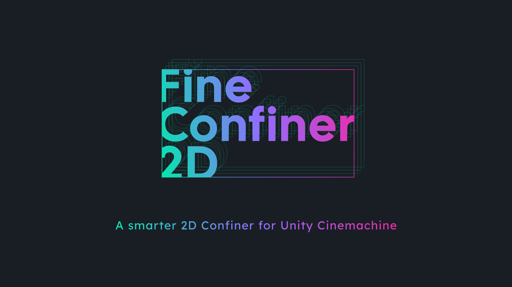

# Fine Confiner 2D

[English](README.md) | 日本語

Cinemachine による 2D カメラ実装において、カメラが映せる領域を制限する Confiner です。Cinmeachine にビルトインの Confiner 2D のいくつかの不便さを解決しています。



Cinemachine の Confiner 2D は減衰の*後*にカメラ位置を補正するため、凹んだ角でカメラが境界をはみ出したり飛んだりします。Fine Confiner 2D は

1. 境界形状から **カメラ中心が取りうる領域** を bake し(多角形をカメラ窓の分だけ内側へ縮める)、
2. 境界と領域の間の「オフセット波面」を使って **ターゲット** を領域内のカメラ位置へ写像し(最近傍点と違ってこの写像は*連続*なので、ターゲットが凹んだ角を回っても目標が飛びません)、
3. その目標へ向けて、領域の境界に沿って滑らせながらカメラを動かします。

そのため、カメラが境界の外に出ることも、飛ぶこともありません。

bake は .NET のスレッドプール上で実行され、毎フレームの問い合わせはアロケーションを発生させません。


## 動作要件

- Unity 6000.3 以降
- [Cinemachine](https://docs.unity3d.com/Packages/com.unity.cinemachine@3.1/manual/index.html) 3.1 以降
- [Clipper2](https://www.nuget.org/packages/Clipper2) 2.0 以降(NuGet。インストール手順を参照)

## インストール

### 1. NuGet から Clipper2 をインストールする(必須)

Fine Confiner 2D は多角形のオフセット計算に [Clipper2](https://github.com/AngusJohnson/Clipper2)(Boost Software License)を使用します。パッケージには**同梱していない**ため、[NuGetForUnity](https://github.com/GlitchEnzo/NuGetForUnity) で NuGet からインストールしてください。

1. NuGetForUnity をプロジェクトに追加します(Package Manager → *Add package from git URL*):
   `https://github.com/GlitchEnzo/NuGetForUnity.git?path=/src/NuGetForUnity`
2. **NuGet → Manage NuGet Packages** を開き、`Clipper2` を検索してインストールします(2.0.0 以降)。

### 2. Fine Confiner 2D をインストールする

Package Manager → *Add package from git URL*:

```
https://github.com/ruccho/FineConfiner2D.git?path=/Packages/com.ruccho.fine-confiner-2d#release
```

## クイックスタート

1. **境界を作る。** `CompositeCollider2D` (と、それが要求する `Rigidbody2D`。*Static* に設定) を持つ GameObject を作り、子として `BoxCollider2D` / `PolygonCollider2D` を追加して *Composite Operation* を *Merge* にします。何とも衝突させたくない場合はトリガーにしてください。
2. **`FineConfiner` を追加する。** 任意の GameObject に `FineConfiner` コンポーネントを付け、*Initial Shape* に `CompositeCollider2D` を割り当てます。シーン開始時にワーカースレッドで領域が bake されます。


3. **カメラを設定する。** `CinemachineCamera` から `CinemachinePositionComposer` と `CinemachineConfiner2D`(あれば)を外し、**Fine Confiner Body** (*Cinemachine → Procedural → Position Control*) を追加して、*Confiner* に `FineConfiner` を割り当て、*Tracking Target* を設定します。
4. **調整する。** *Damping* はカメラの移動の速さを決めます。*Dead Zone*、*Hard Limits*、*Lookahead*、*Screen Position* は Position Composer の同名項目と同じように動作します。


Scene ビューで `FineConfiner` を選択すると bake された領域(緑)と経路のノード(白い点)が表示されます。

### 境界の設計

Fine Confiner Body は「カメラ窓は境界の外に出ない」原則を維持します。したがって、**カメラが通過するすべての通路は窓以上の大きさ** (幅 ≥ `2 × OrthographicSize × Aspect`、高さ ≥ `2 × OrthographicSize`) でなければなりません。窓より狭い通路があると領域は複数の島に分断され、カメラは島の間を移動できず、ターゲットが画面外に出ても島の端で待機します。この状態になると `FineConfiner` は警告をログに出し、島ごとに異なる色で領域を描画します。

窓の幅は画面のアスペクト比で変わるため、対応する最も横長のアスペクト比を基準に境界を設計してください (またはレターボックスでアスペクト比を固定してください)。

### 実行時に境界を変更する

```csharp
// 例: レベルの一区画を読み込んだとき
confiner.SetShape(compositeCollider);      // 非同期 bake を開始
await confiner.WaitForBakeAsync();         // 任意: 新しい領域が有効になるまで待つ
cinemachineCamera.ForceCameraPosition(     // 任意: テレポート後にカメラを即座に合わせる
    player.position, Quaternion.identity);
```

`SetShape(IReadOnlyList<Vector2[]>)` は任意のワールド座標の多角形を受け付け、`ClearShape()` で閉じ込めを無効にできます。

## サンプル

**Basic Sample** — L 字に繋がる部屋、通路、トンネルを持つ見下ろし型のシーンです(すべてカメラ窓が収まる大きさ)。Package Manager → *Fine Confiner 2D* → *Samples* からインポートし、`BasicSample.unity` を開いて WASD / 矢印キーで歩き回ってください。

## コンポーネント

- `FineConfiner`(MonoBehaviour)— 境界形状(`SetShape(CompositeCollider2D)` / `SetShape(loops)`)と窓サイズを保持し、`ConfineRegion` を非同期に bake します。`WaitForBakeAsync()` で、領域の準備が整うまでレベルのロード完了を遅らせることができます。
- `FineConfinerBody`(Cinemachine の Body ステージ)— `CinemachinePositionComposer` + `CinemachineConfiner2D` の代替です。Lookahead、DeadZone、HardLimits、ScreenPosition を Position Composer と同じ意味で扱えます。
- `ConfineRegion` / `ConfinedFollower` / `RegionBaker` — エンジン非依存のコア(`UnityEngine` の数学型にのみ依存)。独自の連携を組む際に利用できます。

## ライセンス

MIT
